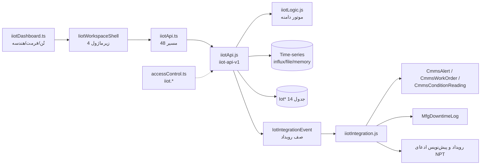
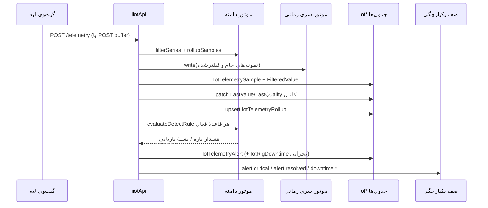
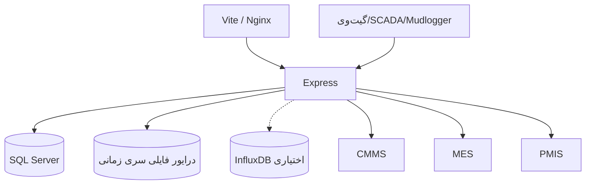

# IIoT Deliverable 1 — معماری سامانهٔ پایش میدانی، اینترنت اشیاء و تله‌متری حفاری

خلاصه ۳ خط: دامنهٔ کلید، **دکل** است نه پروژه؛ همهٔ جدول‌های `Iot*` با
`RigId` و ارزیابی مجوز با `plantId = rigId` کار می‌کنند (fail-closed).
منطق در موتور دامنه (`iiotLogic.js` از `iiotDomain.ts`) است و HTTP فقط
اعتبارسنجی و ماندگاری می‌کند. تله‌متری یک مسیر نوشتن و دو مقصد دارد
(موتور سری زمانی + `IotTelemetrySample`) و یکپارچگی بین‌بخشی از راه
**صف رویداد** است، نه کلید خارجی.

پیوند: سایدبار بخش ۵ دست‌نخورده می‌ماند؛ ورک‌اسپیس در همان صفحهٔ حوزه
رندر می‌شود. مرجع‌های CMMS/MES/PMIS **نرم**اند (`CmmsSiteRef`,
`MesWorkCenterRef`, `PmisProjectRef`) و از دکل به رویداد ارث می‌رسند.

---

## ۱. لایه‌ها

1. **UI** — React/Vite. `IiotWorkspaceShell.tsx` پوستهٔ چهار زیرماژول
   (Drilling DAS · Devices · Condition · Alerts) است؛ اجزای مشترک در
   `IiotUi.tsx` و پنل‌های عملیاتی در `IiotOpsViews.tsx`. هیچ محاسبهٔ
   دامنه‌ای در کامپوننت نیست: تُن رنگ، فرمت مقدار، هندسهٔ نمودار و خلاصه‌ها
   از `src/services/iiotDashboard.ts` (بدون DOM، آزمون‌پذیر در Node) می‌آید.
2. **Client** — `src/services/iiotApi.ts`: پوشش ۴۸ مسیر REST با هدر هویت
   `x-user-id` و قفل خوش‌بینانهٔ `If-Match`. کلیدهای ردیف PascalCase
   (قرارداد لایهٔ ماندگاری) و فقط در لبهٔ نمایش ترجمه می‌شوند.
3. **API** — `server/iiotApi.js` (`IIOT_API_VERSION = "iiot-api-v1"`)،
   ۴۸ مسیر زیر `/api/iiot/rigs/:rigId` به‌علاوهٔ `GET|POST /api/iiot/rigs`.
   سقف ۵۰۰۰ نمونه در هر درخواست، خواندن سری حداکثر ۵۰۰۰ نقطه،
   کوچک‌سازی نمودار حداکثر ۱۲۰ نقطه.
4. **Domain** — `src/services/iiotDomain.ts` → `server/iiotLogic.js`
   (esbuild). فیلترینگ، آستانه‌ها، Stick-Slip، Pump-Drop، NPT، چک‌سام بافر و
   رنگ وضعیت همه اینجا محاسبه می‌شوند. یک منبع حقیقت برای UI/API/آزمون.
5. **Time-series** — `server/iiotTimeSeries.mjs` با سه درایور هم‌قرارداد
   `influx | file | memory` (`IIOT_TS_DRIVER`)؛ `write`، `query`، `latest`،
   `health`. نبود درایور، خطا نیست: مسیر SQL-محور جایگزین می‌شود.
6. **Persistence** — ۱۴ جدول `Iot*` با مهاجرت `0059`
   (`iiot_field_monitoring_das_telemetry`) در `src/services/persistence.ts`.
7. **Integration** — `server/iiotIntegration.js`: پل سمت مقصد برای سه قرارداد
   `iiot-cmms-v1` / `iiot-mes-v1` / `iiot-pmis-v1`؛ مسیرهای
   `POST /api/{cmms,mes,pmis}/iiot-events` برای استقرار جدا و حمل‌ونقل
   درون‌فرآیندی برای استقرار تک‌پروسه‌ای.
8. **RBAC** — ۳۳ مجوز `iiot.*` در `src/services/accessControl.ts` با سه نقش
   `iiot_engineer`، `drilling_supervisor`، `field_iot_technician` و وراثت
   `admin`.

## ۲. چیدمان مؤلفه‌ها

## ۳. جریان داده

## ۴. چهار تصمیم معماری

1. **دامنهٔ دکل، نه پروژه.** دکل بین چند چاه و پیمان جابه‌جا می‌شود؛
   `plantId = rigId` ارزیابی می‌شود و کاربر بیرون دامنه ۴۰۳
   (`IIOT_RIG_SCOPE_DENIED`) می‌گیرد، نه فهرست خالی.
2. **منطق در موتور دامنه، نه در HTTP.** `iiot.domain.test.mjs` ریاضی را
   می‌آزماید و `iiot.rest.test.mjs` فقط می‌سنجد HTTP همان عدد را برمی‌گرداند.
   نسخهٔ مدل (`iiot-v1`) در پاسخ مسیرها برمی‌گردد تا UI/آزمون/گزارش یکی بمانند.
3. **تله‌متری یک مسیر نوشتن، دو مقصد.** نمونه‌ها هم در موتور سری زمانی و هم
   در `IotTelemetrySample` نوشته می‌شوند؛ نمودارها از همان ردیف‌های سروشده
   می‌خوانند تا دو منبع واگرا نشوند. خطای موتور سری زمانی تحمل می‌شود
   (پاسخ `timeSeries.ok = false`) و درج رابطه‌ای هرگز قربانی نمی‌شود.
4. **یکپارچگی با صف، نه FK.** هشدار بحرانی → `IotIntegrationEvent` →
   `integrationTransport`. نبود حمل‌ونقل خطا نیست: رویداد در صف می‌ماند و
   «تحویل‌نشده» گزارش می‌شود؛ هر رویداد `IdempotencyKey` دارد و تحویل دوباره
   ردیف دوباره نمی‌سازد.

## ۵. Store-and-Forward (لبه)

- `IotEdgeGateway` ظرفیت بافر، `MaxBatchSize` و `MaxAttempts` دارد؛
  وضعیت اتصال `online | degraded | offline` است و `fillPct` از موتور دامنه
  می‌آید.
- دستهٔ بافرشده در `IotGatewayBuffer` با `Status` ∈
  `buffered | sending | sent | failed | dead-letter` و `Attempts` می‌نشیند.
- ترتیب بازیابی: قدیمی‌تر اول (`CapturedAt`)؛ تنها وضعیت‌های بازیابی‌پذیر
  انتخاب می‌شوند. اتمام تلاش‌ها → `dead-letter` با کد `E-IIOT-MAX-ATTEMPTS`.
- همگام‌سازی با `POST .../buffer/:bufferId/sync` رخ می‌دهد که رویدادهای
  پذیرش‌شده را دوباره از همان مسیر `ingestPipeline` می‌گذراند (پس قاعده‌ها
  یک بار اجرا می‌شوند) و گذار وضعیت را در `transition` برمی‌گرداند.

## ۶. تفکیک وظایف (SOD)

| کار | مجوز | نقش نمونه |
|---|---|---|
| پذیرش تله‌متری، تعریف کانال/قاعده/فیلتر | `iiot.telemetry.ingest` `iiot.threshold.edit` `iiot.channel.edit` | `iiot_engineer` |
| تأیید/رفع/منفی‌جعلی هشدار و ارسال به مقصد | `iiot.alert.ack` `iiot.alert.resolve` `iiot.alert.dispatch` | `drilling_supervisor` |
| راستی‌آزمایی NPT (رسمی‌سازی ادعا) | `iiot.downtime.verify` | `drilling_supervisor` |
| ثبت توقف | `iiot.downtime.report` | `drilling_supervisor` |
| همگام‌سازی بافر لبه | `iiot.buffer.sync` | `field_iot_technician` |
| کالیبراسیون سنسور | `iiot.sensor.calibrate` | `field_iot_technician` |
| ثبت عکس وضعیت (CBM) | `iiot.condition.record` | `field_iot_technician` |
| ارسال دستی رویداد یکپارچگی | `iiot.integration.dispatch` | `drilling_supervisor` |

قاعدهٔ ثابت: **تنظیم‌کنندهٔ قاعده، تأییدکنندهٔ هشدار نیست** و
**تکنسین میدان، بافر را همگام می‌کند ولی نمی‌تواند آن را دستی ببندد**
(`sync` فقط با اتصال موفق یا شکست دسته‌بندی‌شده).

## ۷. UI

- چهار زیرماژول: `drilling-das` (داشبورد زنده + نمودار خام/فیلترشده + گیج‌ها)،
  `iot-devices` (جریان‌ها، گیت‌وی‌ها، بافر، کالیبراسیون)،
  `condition-monitoring` (کانال‌ها، ثبت قرائت، عکس‌های وضعیت)،
  `sensor-alerts` (هشدارها، قواعد، NPT، صف یکپارچگی).
- تازه‌سازی با `usePolled` انجام می‌شود: تایمر با `live=false` می‌ایستد ولی
  دادهٔ روی صفحه نمی‌پرد؛ دکمهٔ توقف صفحه را سیاه نمی‌کند.
- دکمه‌های عملیاتی از `actionGates(userId, rigId)` غیرفعال می‌شوند و دلیل
  غیرفعالی نوشته می‌شود؛ تصمیم نهایی همیشه با سرور است.
- حالت خالی (دکل ثبت‌نشده) دکمهٔ «آماده‌سازی دکل نمونه» دارد که همان دکل
  آزمون‌ها را از راه REST می‌سازد: دکل → گیت‌وی → جریان → ۶ کانال →
  ۴ قاعده → ۱۰ دقیقه نمونهٔ تله‌متری. هیچ اسکریپت seed اجرا نمی‌شود.

## ۸. استقرار

- در استقرار تک‌پروسه‌ای، `server/index.js` پل سمت مقصد را درون‌فرآیندی
  تزریق می‌کند (بدون حلقهٔ HTTP) و مسیرهای REST مقصد برای استقرار جدا
  باقی می‌مانند.
- متغیرها: `IIOT_TS_DRIVER` (پیش‌فرض `file`)، `IIOT_INFLUX_URL/TOKEN/ORG/BUCKET`
  برای Influx، `IIOT_TS_MEASUREMENT`، `IIOT_TS_MIRROR`،
  `IIOT_CLAIM_THRESHOLD_MINUTES` (پیش‌فرض ۲۴۰ دقیقه).
