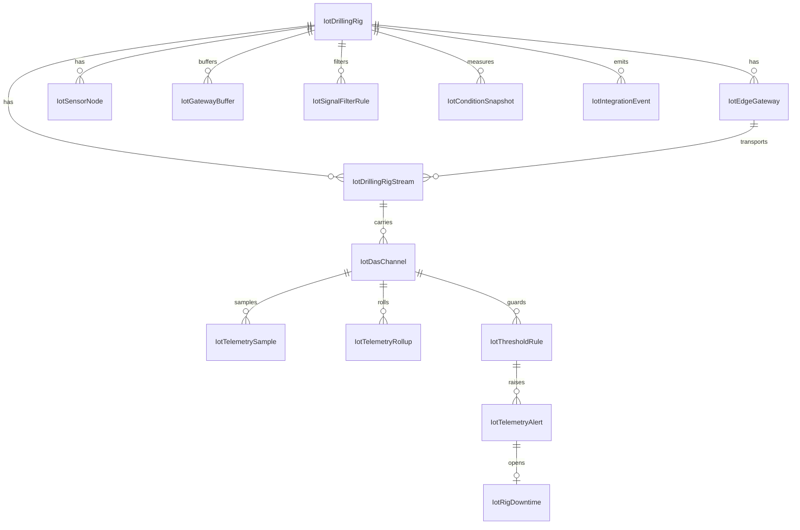

# IIoT Deliverable 2 — مدل داده

خلاصه ۳ خط: ۱۴ جدول `Iot*` با مهاجرت `0059`؛ هیچ کلید خارجی بین‌بخشی
وجود ندارد و مرجع‌های CMMS/MES/PMIS **نرم**اند. کلید دامنه `RigId` است و
هر جدول فرزند با `(RigId, Code)` یکتایی می‌گیرد. سری زمانی دو جا می‌نشیند
(جدول نمونه + موتور سری زمانی) و رویداد بین‌بخشی از `IotIntegrationEvent`
با `IdempotencyKey` یکتا بیرون می‌رود.

مبنا: `src/services/iiotSchema.ts` (منبع حقیقت چک‌ها و ایندکس‌ها) +
مهاجرت `0059` در `src/services/persistence.ts`. ترتیب و انطباق جدول‌ها با
`server/iiot.schema.test.mjs` قفل شده است.

---

## قرارداد نوع

- شناسه/کد: `text(60)` با الگوی `[A-Za-z0-9_-]` برای شناسه و
  `[A-Za-z0-9][A-Za-z0-9._/-]*` برای کد.
- عدد و مقدار: `decimal`؛ درصد `decimal`؛ زمان `datetime`؛ تاریخ `date`.
- JSON فقط برای ساختارهای متغیر: `PayloadJson`، `MetricsJson`،
  `WitsmlMnemonicMapJson`.
- نام ستون‌ها **PascalCase** است (قرارداد لایهٔ ماندگاری) و در لبهٔ نمایش
  ترجمه می‌شود.
- `ModelVersion = "iiot-v1"` روی ردیف‌های مشتق‌شده (هشدار، تجمیع، توقف،
  رویداد) می‌نشیند تا معلوم باشد کدام نسخهٔ مدل آن‌ها را ساخته است.
- همهٔ چک‌ها در همان تعریف جدول‌اند؛ لایهٔ SQL و آزمون اسکیما از یک منبع
  تغذیه می‌شوند.

## ERD

## جدول‌ها

### ۱) `IotDrillingRig` — دکل (ریشهٔ دامنه)

`Id` · `RigId` یکتا · `RigNo` یکتا · `NameFa/NameEn` · `RigType` ∈
`land | jackup | semi-submersible | platform | workover | coiled-tubing` ·
`Status` ∈ `mobilizing | drilling | tripping | cementing | completion |
workover | stacked | demobilized` · `OwnerFa` · `DrillingContractorFa` ·
**مرجع‌های نرم:** `CmmsSiteRef` · `PmisProjectRef` · `MesWorkCenterRef` ·
`FieldName` · `WellName` · `SpudDate` · `TargetDepthM` · `CurrentDepthM` ·
`Latitude/Longitude` · `TimeZoneId` (پیش‌فرض `Asia/Tehran`) ·
`NominalSampleRateHz ≥ 1` · `IsActive` · `NoteFa`.
ایندکس: `UX_RigId`، `UX_RigNo`، `IX (Status, IsActive)`.

### ۲) `IotEdgeGateway` — گیت‌وی لبه

`GatewayCode` یکتا در دکل · `Protocol` ∈ `mqtt | opc-ua | modbus | witsml |
http` · `SyncMode` ∈ `realtime | store-forward | batch` · `FirmwareVersion` ·
`IpAddress` · `LocationFa` · `BufferCapacity` (پیش‌فرض ۱۰۰۰۰۰) · `BufferUsed` ·
`MaxBatchSize ≥ 1` · `MaxAttempts` (پیش‌فرض ۵) · `ConnectionState` ∈
`online | degraded | offline` · `LastHeartbeatAt` · `LastSyncAt` ·
`HeartbeatIntervalSeconds` · `AuthMode` · `IsActive`.
چک کلیدی: `0 ≤ BufferUsed ≤ BufferCapacity`.

### ۳) `IotSensorNode` — سنسور/تگ میدان

`SensorTag` یکتا در دکل · `SensorType` · `Manufacturer/ModelNo/SerialNo` ·
`RangeMin/RangeMax` (چک: خالی یا `Max > Min`) · `Unit` · `AccuracyPct` ·
`LocationFa` · `GatewayId` (نرم) · `InstalledAt` · `LastCalibratedAt` ·
`NextCalibrationDue` (ایندکس برای یادآور) · `CalibrationIntervalDays` ·
`Status` ∈ `active | faulty | calibration-due | removed`.

### ۴) `IotDrillingRigStream` — جریان تله‌متری

`StreamCode` یکتا در دکل · `SourceSystem` ∈ `witsml | mudlogger | plc |
scada | edge | manual` · `TransportProtocol` ∈ `mqtt | opc-ua | modbus |
witsml | http` · `GatewayId` · `SampleRateHz ≥ 1` · `BatchSize` ·
`ConnectionState` ∈ `online | degraded | offline` (`degraded` وقتی نسبت
نمونهٔ سالم < ۸۰٪) · `LastSampleAt` · `LastSeqNo` · `QualityPct` ·
`WitsmlMnemonicMapJson` · `IsActive`.

### ۵) `IotDasChannel` — کانال سیگنال حفاری (DAS)

`ChannelCode` یکتا در دکل · `StreamId` (نرم) · `NameFa/NameEn` · `SignalType`
∈ `wob | rpm | torque | mud-pump-pressure | flow-rate | temperature |
vibration | rop | depth | standpipe-pressure | hookload | gas` · `Unit` ·
`NominalMin/Max/Value` · `DisplayMin/Max` (چک: خالی یا `Max > Min`) ·
`SampleRateHz ≥ 1` · `FilterMethod` ∈ `none | sma | ema | median` (پیش‌فرض
`sma`) · `FilterWindowSeconds ≥ 1` · `DeadbandPct ≥ 0` · `SensorTag` ·
`WitsmlMnemonic` · `IsCritical` · `IsActive` · `InstalledLocationFa` ·
`CalibratedAt` · `NextCalibrationDue` · آخرین وضعیت سری: `LastValueAt` ·
`LastValue` · `LastQuality` · `ModelVersion`.

### ۶) `IotGatewayBuffer` — دستهٔ بافرشده (Store-and-Forward)

`BatchNo` یکتا در گیت‌وی · `CapturedAt` · `FromAt/ToAt` (چک `ToAt ≥ FromAt`) ·
`SampleCount` · `PayloadJson` · `Checksum` · `Status` ∈
`buffered | sending | sent | failed | dead-letter` · `Attempts ≤ MaxAttempts` ·
`LastAttemptAt` · `SentAt` · `AckRef` · `ErrorCode/ErrorFa` ·
`ConnectivityState`.
عبارت `PayloadJson` هرگز در فهرست REST برنمی‌گردد.

### ۷) `IotTelemetrySample` — نمونهٔ تله‌متری

`ChannelId` · `SampledAt` · `Value` · `RawValue` · `FilteredValue` ·
`Unit` · `SeqNo` · `Quality` ∈ `good | suspect | bad | stale` · `Source` ∈
`live | buffer | replay | simulated | manual` · `GatewayId` · `BufferId` ·
`BatchNo` · `IngestedAt` · `IsFlagged` · `QualityReasonFa`.
ایندکس‌ها: `(ChannelId, SampledAt)`، `(RigId, SampledAt)`،
`(RigId, Quality, SampledAt)`، `(BufferId, SampledAt)`.
این جدول پرحجم‌ترین جدول ماژول است؛ رکوردهای قدیمی با همان درایور سری
زمانی و سیاست نگهداشت جدا مدیریت می‌شوند.

### ۸) `IotTelemetryRollup` — تجمیع سطل‌زمانی

`ChannelId` · `BucketSeconds ≥ 1` · `BucketStart` — یکتای مرکب
`(ChannelId, BucketSeconds, BucketStart)` · `SampleCount` · `BadCount` ·
`MinValue/MaxValue/AvgValue` (چک `Max ≥ Min`) · `StdDev` · `FirstValue` ·
`LastValue` · `QualityPct` · `ModelVersion`.
نوشتن idempotent است: تجمیع دوبارهٔ یک سطل، همان ردیف را به‌روز می‌کند.

### ۹) `IotSignalFilterRule` — قاعدهٔ فیلترینگ سیگنال

`RuleCode` یکتا در دکل · `AppliesToSignals` (فهرست جدا‌شده با کاما) ·
`FilterMethod` ∈ `none | sma | ema | median` · `WindowSeconds ≥ 1` ·
`EmaAlpha ∈ (0,1]` · `MinSamples ≥ 1` · `DeadbandPct` · `SpikeZThreshold` ·
`FlatlineSeconds` · `IsDefault` · `Version` · `IsActive` · `EffectiveFrom` ·
`ModelVersion`.

### ۱۰) `IotThresholdRule` — قاعدهٔ آستانه/ناهنجاری چندسطحی

`RuleCode` یکتا در دکل · `ChannelId` (نرم) · `Level` ∈ `warning | critical` ·
`DetectKind` ∈ `threshold | rate-of-change | stick-slip | pump-drop |
flatline | spike` · `Comparison` ∈ `gt | gte | lt | lte | band-out | rate` ·
`ThresholdValue` · `SecondaryValue` (لبهٔ دوم `band-out`) ·
`DurationSeconds` · `MinSamples` · `HysteresisPct` · `CooldownSeconds` ·
شاخص‌های تخصصی: `TorqueCvThreshold` (Stick-Slip) ·
`RpmSwingPctThreshold` · `PressureDropPctThreshold` (Pump-Drop) ·
`AutoDispatch` + `DispatchTargets` (چک: اگر `AutoDispatch` آنگاه مقدار اجباری) ·
مرجع‌های ارسال: `CmmsPriority` · `CmmsSiteRef` · `CmmsAssetRef` ·
`MesWorkCenterRef` · `MesPlantRef` · `PmisProjectRef` · `NptCode` ·
`EscalationNoteFa` · `Version` · `IsActive` · `EffectiveFrom` · `ModelVersion`.

### ۱۱) `IotTelemetryAlert` — هشدار تله‌متری

`AlertCode` یکتا در `(دکل، کد، زمان تشخیص)` · `ChannelId` · `RuleId` ·
`DetectionKind` · `Level` ∈ `warning | critical` · `TitleFa` · `MessageFa` ·
`DetectedAt` · `TriggeredAt` · `ResolvedAt` · `TriggerValue` ·
`FilteredValue` · `BaselineValue` · `DeviationPct` · `SampleCount` ·
`DurationSeconds` · `MetricsJson` · `Status` ∈ `active | acknowledged |
resolved | suppressed | false-positive` · `AcknowledgedAt/ById` ·
`AckNoteFa` · `ResolvedById` (`svc-iiot-auto` برای بستن خودکار) ·
`ResolutionNoteFa` · `SuppressedReasonFa` · `DispatchStatus` ∈
`none | pending | partial | dispatched | failed` ·
`CmmsWorkOrderRef` · `MesDowntimeRef` · `PmisEventRef` · `ModelVersion`.
چک: `Status = 'resolved' ⟹ ResolvedAt IS NOT NULL`.

### ۱۲) `IotRigDowntime` — توقف دکل و زمان نامولّد (NPT)

`DowntimeCode` یکتا در دکل · `Category` ∈ `equipment | mud | directional |
wellbore | weather | power | logistics | cementing | waiting-on-decision |
other` · `DowntimeType` ∈ `productive | non-productive | planned`
(چک: `IsNpt = 0 OR DowntimeType = 'non-productive'`) · `NptCode` ·
`CauseFa` · `EffectFa` · `StartedAt` · `EndedAt` (چک `EndedAt ≥ StartedAt`) ·
`DurationMinutes ≥ 0` · `IsNpt` · `RecoverableMinutes` ·
`ResponsibilityFa` · `AlertId` (هشدار بازکننده) · `DetectedBy` ∈
`auto | manual` · `ShiftName` · `RecordedById` · `VerifiedById` ·
`VerifiedAt` · `ReportedToMes` · `ReportedToPmis` · `MesDowntimeRef` ·
`PmisEventRef` · `PmisClaimRef` · `ModelVersion`.

### ۱۳) `IotIntegrationEvent` — صف یکپارچگی (Outbox)

`EventType` (پنج قرارداد: `alert.critical` · `alert.resolved` ·
`downtime.npt` · `downtime.closed` · `condition.reading`) ·
`TargetSystem` ∈ `cmms | mes | pmis` · `TargetRef` ·
`Contract` ∈ `iiot-cmms-v1 | iiot-mes-v1 | iiot-pmis-v1` ·
`IdempotencyKey` **یکتا** · `CorrelationId` · `SourceTable` · `SourceId` ·
`OccurredAt` · `PayloadJson` · `Status` ∈
`pending | dispatched | failed | dead-letter` · `Attempts ≤ MaxAttempts` ·
`LastAttemptAt` · `DeliveredAt` · `AckRef` · `ErrorCode/ErrorFa` ·
`EmittedBy` · `ModelVersion`.

### ۱۴) `IotConditionSnapshot` — عکس پایش وضعیت (CBM)

`CmmsAssetRef` (نرم) · `SensorTag` · `ReadingType` ∈
`vibration | temperature | humidity | pressure | current | gas | flow` ·
`Value` · `Uom` · `Zone` ∈ `A | B | C | D` (ISO 10816) · `MeasuredAt` ·
`MeasuredOn` · `HealthIndex` · `TrendDirection` ∈ `rising | falling |
stable` · `RateOfChange` · `Source` ∈ `iiot | manual | scada | portable` ·
`ReportedToCmms` · `CmmsReadingRef` · `AlertId`.
ایندکس‌ها: `(RigId, MeasuredOn)`، `(CmmsAssetRef, MeasuredAt)`،
`(RigId, Zone, MeasuredOn)`.

## سری زمانی و تجمیع

- نوشتن نمونه در دو مقصد: موتور سری زمانی (خام + فیلترشده) و
  `IotTelemetrySample`. خواندن نمودار از نمونه‌های رابطه‌ای سرو‌شده انجام
  می‌شود تا مقدار فیلترشده و خام از یک منبع بیاید.
- تجمیع‌ها در `IotTelemetryRollup` می‌نشینند و `POST /telemetry/rollups`
  هر بار بازمحاسبه می‌کند؛ سطل ۶۰ ثانیه پیش‌فرض است.
- `downsample` نمودار جفت min/max هر سطل را می‌دهد (حداکثر ۱۲۰ نقطه) تا
  اسپایک در پنجره‌های بزرگ گم نشود.

## قواعد حاکم بر مدل

1. **بدون FK بین‌بخشی.** تنها FKها درون ماژول‌اند (`ChannelId`، `RuleId`،
   `AlertId`، `GatewayId`، `StreamId`) و در سطح سرویس اعتبارسنجی می‌شوند.
2. **مرجع نرم = تصمیم مقصد.** `CmmsSiteRef`/`CmmsAssetRef` ناشناخته یعنی
   رویداد با خطای دسته‌بندی‌شده در صف می‌ماند، نه ردیف سرگردان.
3. **یکتایی‌ها قراردادی‌اند:** `(RigId, Code)` برای همهٔ رکوردهای کدمحور،
   `(ChannelId, BucketSeconds, BucketStart)` برای تجمیع، `IdempotencyKey`
   برای رویداد، `(GatewayId, BatchNo)` برای دستهٔ بافر.
4. **شاهدِ مقدار.** هر هشدار `TriggerValue`/`FilteredValue`/`DeviationPct`
   دارد و هر رویداد ارسالی `AckRef` یا `ErrorCode`؛ «موفق» بی‌شاهد ثبت
   نمی‌شود.
