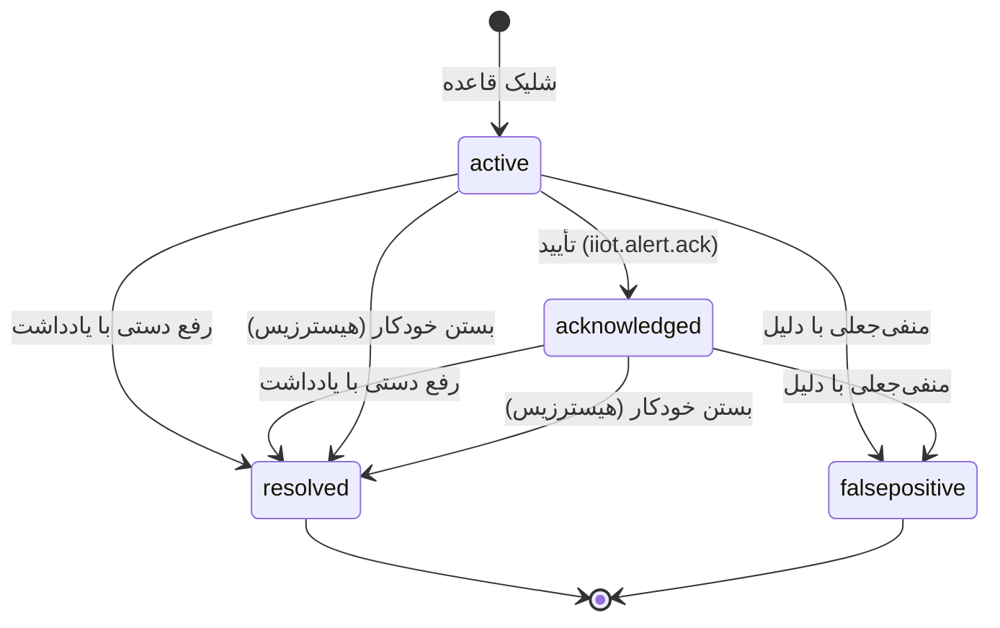

# IIoT Deliverable 3 — خط لولهٔ بلادرنگ، هشدار و NPT

خلاصه ۳ خط: هر نمونه از یک مسیر می‌گذرد: اعتبارسنجی → فیلتر → سری زمانی →
نمونهٔ رابطه‌ای → تجمیع → قاعده‌ها → هشدار → (اگر بحرانی) توقف/NPT و صف
یکپارچگی. هشدار ماشین وضعیت صریح دارد و بستن خودکار فقط با هیسترزیس رخ
می‌دهد. هیچ «موفق»ی بی‌شاهد ثبت نمی‌شود: یا مقدار و مرجع برمی‌گردد یا کد
خطای دسته‌بندی‌شده.

مرجع‌ها: `iiotDomain.ts` (موتور)، `server/iiotApi.js` (مسیرها)، آزمون‌های
`iiot.domain.test.mjs` / `iiot.timeseries.test.mjs` / `iiot.rest.test.mjs` /
`iiot.integration.test.mjs`.

---

## ۱. خط لولهٔ پذیرش (`POST /telemetry`)

| گام | کار | خطا/نتیجه |
|---|---|---|
| اعتبارسنجی رکورد | `channelCode` شناخته‌شده، `at` معتبر، `value` متناهی | `rejected[]` با کد `E-IIOT-UNKNOWN-CHANNEL` / `CHANNEL-INACTIVE` / `BAD-TIME` / `BAD-VALUE` / `SAMPLE-MALFORMED` |
| فهرست کانال | بدون کانال فعال | `IIOT_NO_CHANNELS` (۴۲۲) |
| نمونهٔ سالم | بدون نمونهٔ پذیرفتنی | `IIOT_NO_VALID_SAMPLES` (۴۲۲) |
| ترتیب | مرتب‌سازی بر `SampledAt` | — |
| فیلترینگ | قاعدهٔ مؤثر کانال: `sma` / `ema` / `median` / `none` + deadband | مقدار فیلترشده در `FilteredValue` |
| سری زمانی | نوشتن خام + فیلترشده | شکست تحمل می‌شود (`timeSeries.ok = false`) |
| ماندگاری | `IotTelemetrySample` + وصلهٔ `LastValue/LastValueAt/LastQuality` کانال | درج رابطه‌ای هرگز قربانی نمی‌شود |
| تجمیع | `rollupSamples` سطل پیش‌فرض ۶۰ ثانیه، idempotent | بازمحاسبهٔ سطل، ردیف تکراری نمی‌سازد |
| کیفیت جریان | نسبت سالم < ۸۰٪ → `ConnectionState = degraded` | روی `IotDrillingRigStream` |
| قاعده‌ها | `evaluateDetectRule` برای هر قاعدهٔ فعال کانال | `alerts.created` / `alerts.resolved` / `alerts.suppressed` |
| توقف | هشدار `critical` تازه → یک `IotRigDowntime` (`DetectedBy = auto`) | فقط یک بار به ازای هشدار |
| صف | رویدادهای `alert.critical` / `alert.resolved` | `EmittedBy` = کاربر جاری |

گرم‌شدن فیلتر (warm-up): چند مقدار اول سری `FilteredValue = NULL` می‌گیرند؛
این درست است، نه اشکال. در خواندن تله‌متری، همان مقدار فیلترشده از ردیف
نمونه برگردانده می‌شود تا نمودار «خام در برابر فیلترشده» یک منبع داشته باشد.

## ۲. سیگنال و فیلتر

- ۱۲ نوع سیگنال (`SIGNAL_TYPES`) با واحد و محدودهٔ نمایشی استاندارد؛ UI هیچ
  عددی نمی‌سازد.
- روش‌های فیلتر: `sma` پنجره‌ای، `ema` با `EmaAlpha`، `median` مقاوم به
  اسپایک، `none` برای سیگنال‌های شمارشی.
- `DeadbandPct` تغییرات کوچک را نگه می‌دارد تا نویز، نمودار و هشدار نسازد.
- تشخیص‌های مکمل روی پنجره: `spike` با آستانهٔ z، `flatline` برای سنسور
  چسبیده.

## ۳. موتور قاعده (`IotThresholdRule`)

| DetectKind | معنا | پارامتر کلیدی |
|---|---|---|
| `threshold` | مقایسهٔ ساده | `Comparison` ∈ `gt/gte/lt/lte/band-out` + `ThresholdValue`/`SecondaryValue` |
| `rate-of-change` | شیب زمانی | `Comparison = rate` + `ThresholdValue` (واحد بر ثانیه) |
| `stick-slip` | ضریب تغییرات گشتاور | `TorqueCvThreshold` + `RpmSwingPctThreshold` |
| `pump-drop` | افت فشار پمپ گل | `PressureDropPctThreshold` |
| `flatline` | سیگنال یخ‌زده | `FlatlineSeconds` |
| `spike` | پرش ناگهانی | `SpikeZThreshold` (قاعده) / `ThresholdValue` |

شرط شلیک: **تداوم** (`DurationSeconds`) و **حداقل نمونه** (`MinSamples`) —
یک نمونهٔ سرگردان هشدار نمی‌سازد. بعد از شلیک، `CooldownSeconds` از طوفان
هشدار جلوگیری می‌کند و در پاسخ `alerts.suppressed` با دلیل
`E-IIOT-COOLDOWN` ثبت می‌شود. بستن خودکار تنها وقتی رخ می‌دهد که مقدار
فیلترشده به اندازهٔ `HysteresisPct` زیر آستانه برگردد؛ بستن با
`ResolvedById = "svc-iiot-auto"` مهر می‌شود.

## ۴. چرخهٔ عمر هشدار

- **تأیید** فقط از `active` یا `acknowledged`؛ هر وضعیت دیگری ۴۲۲
  `IIOT_ALERT_STATE` می‌دهد.
- **رفع** نیازمند `ResolutionNoteFa` است و توقف باز متصل را می‌بندد.
- **منفی‌جعلی** نیازمند `SuppressedReasonFa` است و توقف زائدی که همان هشدار
  باز کرده بود را حذف می‌کند (`revertedDowntime` در پاسخ).
- **ارسال به مقصد** با `POST /alerts/:alertId/dispatch` و فهرست اختیاری
  `targets`؛ نتیجهٔ `DispatchStatus` ∈ `none | pending | partial |
  dispatched | failed` و مرجع هر مقصد در ستون خودش می‌نشیند.
- همهٔ گذارها با `If-Match` قفل خوش‌بینانه دارند؛ تعارض → ۴۰۹
  `IIOT_CONCURRENCY_CONFLICT`.

## ۵. Dispatch خودکار و صف یکپارچگی

پنج قرارداد رویداد: `alert.critical`، `alert.resolved`، `downtime.npt`،
`downtime.closed`، `condition.reading`.

| رویداد | مقصد | اثر در سامانهٔ مقصد |
|---|---|---|
| `alert.critical` | cmms | `CmmsAlert` + `CmmsWorkOrder` (+ درخواست کار اگر دارایی شناخته شود) |
| `alert.critical` | mes | `MfgDowntimeLog` ناخواسته |
| `alert.resolved` | cmms | بستن همان هشدار/دستورکار با `opensKey` |
| `downtime.npt` | mes | ثبت توقف در تقویم تولید |
| `downtime.closed` | pmis | ثبت NPT و پیش‌نویس ادعا (در صورت شایستگی) |
| `condition.reading` | cmms | `CmmsConditionReading` با `Source = iiot` |

- هر رویداد `IdempotencyKey` یکتا دارد؛ تحویل دوباره ردیف دوباره نمی‌سازد
  و پاسخ `duplicated: true` می‌دهد.
- ارسال دستی برای رویداد تحویل‌شده ۴۲۲ `IIOT_EVENT_DELIVERED` و برای شکست
  حمل‌ونقل `IIOT_DELIVERY_FAILED` می‌دهد.
- `AutoDispatch` روی قاعده به معنای ارث مرجع‌های دکل/قاعده به رویداد است؛
  اگر مقصد به مرجع نیاز داشته باشد و نداشته باشد، رویداد در صف می‌ماند.

## ۶. توقف و NPT

- `POST /downtime` توقف دستی می‌سازد و مرجع‌های نرم دکل را ارث می‌برد؛
  `close` زمان پایان را می‌بندد و `verify` تنها راه **رسمی‌کردن** NPT است
  (ارسال به mes و pmis؛ هرگز cmms). خطاها: `IIOT_DOWNTIME_OPEN`,
  `IIOT_DOWNTIME_CLOSED`, `IIOT_DOWNTIME_VERIFIED`.
- دسته‌ها همان ۱۰ دستهٔ مدل داده؛ `classifyDowntime` دستهٔ پیش‌فرض/کد NPT را
  تعیین می‌کند. هشدار بحرانی، دستهٔ `equipment` (یا کد NPT قاعده) می‌گیرد.
- `GET /npt/summary` خلاصهٔ زنده می‌دهد: `totalMinutes`،
  `productiveMinutes`، `nptMinutes`، `plannedMinutes`، `nptPct`،
  `byCategory[]`، `openCount`، `asOf`.
- **نامزد ادعا:** توقف بسته و راستی‌آزمایی‌شده با مدت بیش از
  `claimThresholdMinutes` (پیش‌فرض ۲۴۰ دقیقه، قابل تنظیم با
  `IIOT_CLAIM_THRESHOLD_MINUTES`) که مسئولیت آن پیمانکار نیست.
  `claimWorthy` برای مسئولیت «پیمانکار» همیشه `false` است.

## ۷. داشبورد و پایش وضعیت

- `GET /dashboard` گیج‌ها را با رنگ وضعیت محاسبه‌شدهٔ سروی می‌دهد
  (`statusColorFor`): `normal` / `warning` / `critical`، به‌علاوهٔ نشانهٔ
  `stale` وقتی سن داده بیش از ۳۰۰ ثانیه است. UI هرگز آستانه را دوباره
  حساب نمی‌کند.
- `GET /telemetry/latest` مقدار آخر هر کانال را با همان رنگ و `asOf` می‌دهد.
- عکس‌های CBM (`IotConditionSnapshot`) با `HealthIndex` و `TrendDirection`
  ذخیره می‌شوند (مسیر ثبت، `ReportedToCmms = false` می‌گذارد).
  قرارداد `condition.reading` در پل مقصد پشتیبانی می‌شود و همان خوراک CBM
  است که فاز ۴ CMMS انتظارش را دارد؛ اتصال خودکار این مسیر به نت، از
  شکاف‌های باز است.

## ۸. نگاشت اکشن UI ↔ مجوز

| دکمه در UI | مجوز | نقش |
|---|---|---|
| تزریق نمونهٔ آزمایشی | `iiot.telemetry.ingest` | `iiot_engineer` |
| تأیید / رفع / منفی‌جعلی / ارسال هشدار | `iiot.alert.ack` / `.resolve` / `.resolve` / `.dispatch` | `drilling_supervisor` |
| آزمون خشک قاعده، ساخت/ویرایش قاعده | `iiot.threshold.view` / `iiot.threshold.edit` | `iiot_engineer` |
| همگام‌سازی و علامت‌زدن دستهٔ بافر | `iiot.buffer.sync` | `field_iot_technician` |
| کالیبراسیون سنسور | `iiot.sensor.calibrate` | `field_iot_technician` |
| ثبت قرائت وضعیت | `iiot.condition.record` | `field_iot_technician` |
| بستن و راستی‌آزمایی توقف | `iiot.downtime.report` / `iiot.downtime.verify` | `drilling_supervisor` |
| تلاش دوبارهٔ صف یکپارچگی | `iiot.integration.dispatch` | `drilling_supervisor` |

## ۹. شواهد آزمون

- `iiot.domain.test.mjs` (۵۷): ریاضی فیلتر، آستانه، Stick-Slip، NPT،
  چک‌سام و بازیابی بافر، بدون HTTP.
- `iiot.timeseries.test.mjs` (۳۲): قرارداد درایورها و رفتار حافظه.
- `iiot.rest.test.mjs` (۷۸): ۴۸ مسیر، کدهای خطا، قفل خوش‌بینانه، ممنوعیت
  دامنه، بدون درز `PayloadJson`.
- `iiot.integration.test.mjs` (۱۷): پنج قرارداد رویداد و idempotency.
- `iiot.dashboard.test.mjs` (۲۵) + `iiot.dashboard.rest.test.mjs` (۷):
  تُن/فرمت/هندسهٔ نمودار، خلاصه‌ها، گیج‌ها و زنجیرهٔ سرور → نمودار.
